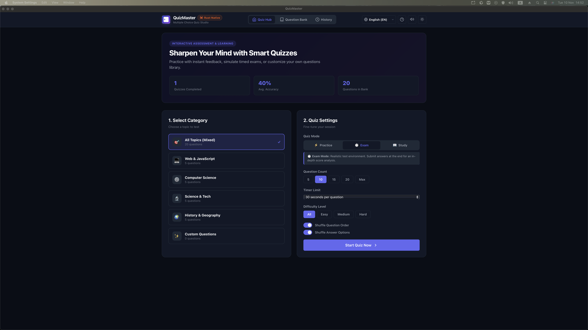
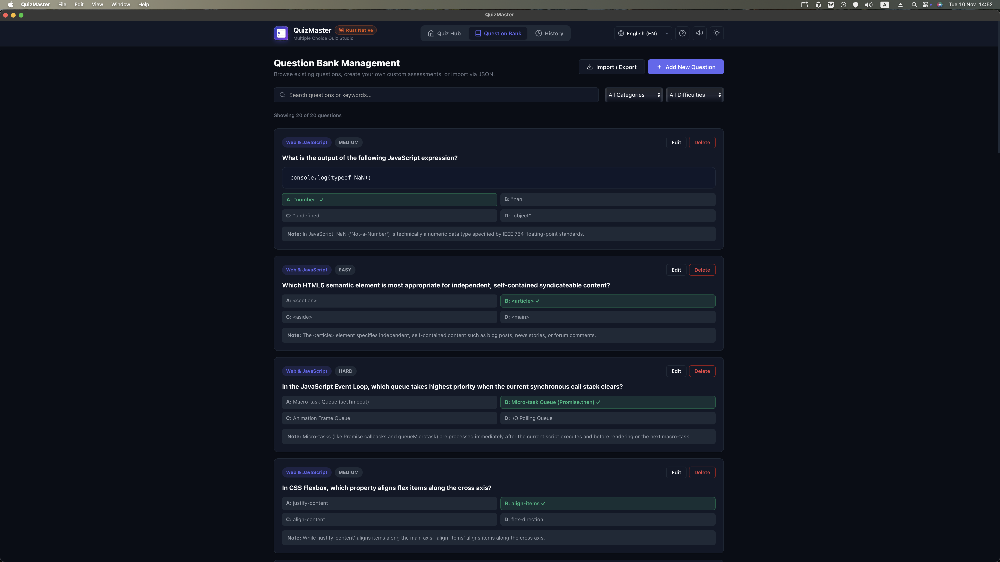
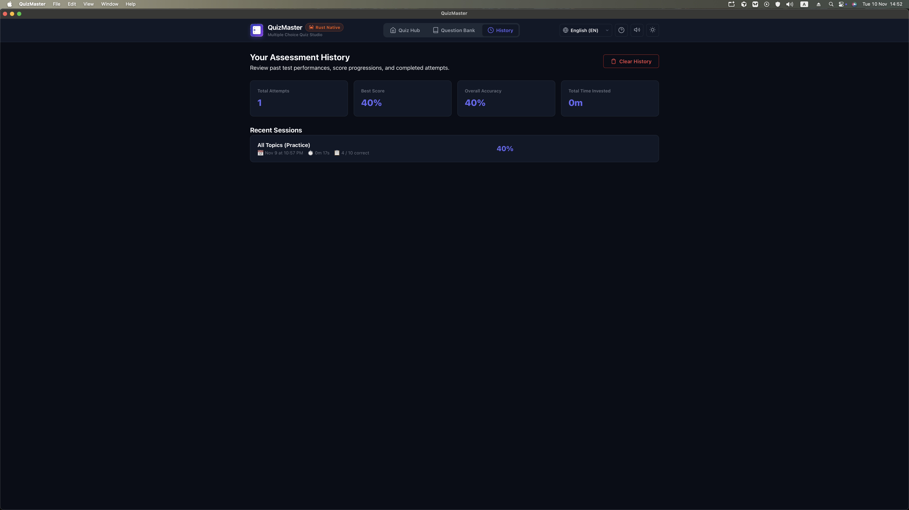

# QuizMaster

QuizMaster is a desktop multiple-choice quiz studio built with Tauri v2, Rust, and a vanilla HTML/CSS/JavaScript frontend. Create and take quizzes, manage question banks, and review past results in one place.

## Screenshots

### Quiz Hub

Choose a topic and configure a practice, exam, or study session. Set the question count, timer, difficulty, and shuffle options before starting.

### Question Bank

Search and filter questions, review their answer choices, and add, edit, delete, or import and export questions.

### Assessment History

Review completed sessions, including attempts, best score, overall accuracy, time invested, and per-session results.

## Question Bank & Customization

Questions are stored in human-readable JSON and can be customized:

- [questions.json](questions.json): the question database.
- [questions.schema.json](questions.schema.json): JSON schema for editor autocomplete and validation.
- [QUESTIONS_GUIDE.md](QUESTIONS_GUIDE.md): instructions and examples for editing questions.

The `correct` field accepts a zero-based answer index (`0`–`3`), an option letter (`"A"`–`"D"`), or the exact option text. IDs can be generated automatically, and category and difficulty have defaults. The app supports importing JSON by file picker or drag and drop, replacing or merging a bank, and syncing from `questions.json`.

## Development

The Tauri application is in [`multiple-choise-test/`](multiple-choise-test/). See its [README](multiple-choise-test/README.md) for project-specific setup instructions.
